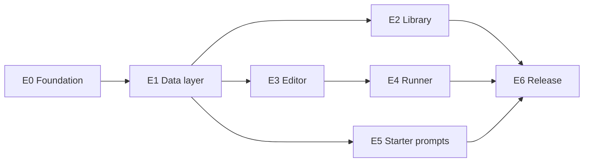

# PromptVault — Epics & Backlog

Planning backlog for the PromptVault Android MVP. Product direction and stack notes live in [idea.md](idea.md). This document is the source of truth for implementation order, task sizing, and release criteria.

---

## Purpose and scope

PromptVault is a local-first Flutter app for saving AI prompts, filling `{{variable}}` placeholders, and copying the finished text to the clipboard. Version 1 targets a fast Play Store release with no backend and no account system.

### In scope (MVP v1.0)

- Prompt create, read, update, delete (CRUD)
- Library home screen with search
- Favorites (toggle + filter)
- Variable detection, runner UI, live preview, clipboard copy
- Bundled starter prompts on first launch
- Android release via Google Play (production)

### Out of scope (post-launch — see E7)

- Categories and tags with filter chips
- JSON import/export
- Prompt versioning / duplicate
- Share sheet integration
- iOS build

### Technology (v1)

| Component        | Choice                          |
| ---------------- | ------------------------------- |
| Framework        | Flutter / Dart                  |
| State            | Riverpod                        |
| Database         | SQLite (`sqflite`)              |
| Navigation       | `go_router`                     |
| Models           | `freezed` + `json_serializable` |
| Clipboard        | `flutter/services.dart`         |
| Backend          | None                            |

---

## Global Definition of Ready (DoR)

Every task must satisfy these before work starts (unless a task lists extra DoR items):

1. **Outcome** — One sentence describes the user-visible or technical result.
2. **Dependencies** — All listed prerequisite task IDs are marked done.
3. **Acceptance criteria** — Bullet list exists; UI tasks name the screen in [idea.md](idea.md) (Library, Editor, or Runner).
4. **Size** — Estimated at half a day or less; larger work is split into additional tasks.

---

## Global Definition of Done (DoD)

Every task must satisfy these before it is closed (unless a task lists extra DoD items):

1. **Quality gate** — Changes on `main`; `flutter analyze` has no issues; `flutter test` passes.
2. **Logic tests** — Non-widget logic (repositories, template engine, parsers) has unit tests.
3. **Verification** — Manually checked on Android emulator or device; release-mode check when the task touches build/signing or store artifacts.
4. **Hygiene** — No stray `TODO` comments without a backlog ID (e.g. `E7-…`).

**Estimate key:** S ≈ 2–4 hours, M ≈ 4–8 hours.

---

## Epic dependency order



**Parallel work:** E6-T1, E6-T2, E6-T4, and E6-T5 can start while E2–E5 are in progress to shorten time-to-store.

---

## E0 — Project foundation

**Goal:** Runnable Flutter Android project with theme, routing, and an empty Library shell.

**Exit criterion:** App launches to Library screen; navigation routes exist; analyze/test baseline green.

### E0-T1 — Create Flutter project

| Field | Detail |
| ----- | ------ |
| **Estimate** | S |
| **Depends on** | — |

**DoR**

- Application ID chosen (e.g. `com.<owner>.promptvault`).

**Acceptance criteria**

- `flutter create` with Android only (no iOS/web/desktop targets unless explicitly needed).
- `minSdk` 23; `targetSdk` matches current Google Play requirement.
- App runs on emulator: default counter demo replaced later in E0-T4.

**DoD**

- `flutter run` succeeds on Android.
- Package name documented in README stub.

---

### E0-T2 — Dependencies and codegen

| Field | Detail |
| ----- | ------ |
| **Estimate** | S |
| **Depends on** | E0-T1 |

**DoR**

- Package versions pinned in `pubspec.yaml` (compatible set).

**Acceptance criteria**

- Add: `flutter_riverpod`, `go_router`, `sqflite`, `path`, `freezed_annotation`, `json_annotation`.
- Dev: `build_runner`, `freezed`, `json_serializable`, `flutter_lints`.
- `flutter pub get` succeeds; `dart run build_runner build` runs without error (even if no models yet).

**DoD**

- `analysis_options.yaml` uses `flutter_lints`.
- Document codegen command in README.

---

### E0-T3 — Folder structure

| Field | Detail |
| ----- | ------ |
| **Estimate** | S |
| **Depends on** | E0-T1 |

**DoR**

- Structure matches [idea.md](idea.md) feature layout.

**Acceptance criteria**

```
lib/
├── app/          # app.dart, router.dart, theme.dart
├── core/         # database/, utils/, widgets/
├── features/
│   ├── prompts/  # data/, domain/, presentation/
│   ├── favorites/
│   └── settings/
└── main.dart
```

- Placeholder files or exports so imports resolve.

**DoD**

- No analysis errors from missing import paths.

---

### E0-T4 — Theme and routing

| Field | Detail |
| ----- | ------ |
| **Estimate** | M |
| **Depends on** | E0-T2, E0-T3 |

**DoR**

- Route list agreed with MVP screens.

**Acceptance criteria**

- Material 3 theme; light mode + system dark mode.
- `go_router` routes:
  - `/` — Library (placeholder scaffold)
  - `/prompt/new` — Editor (create)
  - `/prompt/:id/edit` — Editor (edit)
  - `/prompt/:id/run` — Runner (placeholder)
- `ProviderScope` wraps app in `main.dart`.

**DoD**

- Manual navigation to each route works from temporary debug actions or shell buttons.

---

### E0-T5 — Git and CI baseline

| Field | Detail |
| ----- | ------ |
| **Estimate** | S |
| **Depends on** | E0-T4 |

**DoR**

- Remote repository URL decided (optional).

**Acceptance criteria**

- Git initialized; Flutter `.gitignore` present.
- Initial commit on `main`.
- Optional: GitHub Action running `flutter analyze` and `flutter test` on push.

**DoD**

- CI green on `main` if workflow added.

---

## E1 — Data layer

**Goal:** Persistent prompts in SQLite with repository API and Riverpod wiring.

**Exit criterion:** CRUD + search + favorite toggle work via repository; unit tests pass on desktop with `sqflite_common_ffi`.

### E1-T1 — Prompt domain model

| Field | Detail |
| ----- | ------ |
| **Estimate** | S |
| **Depends on** | E0-T2 |

**DoR**

- Field list frozen for v1.

**Acceptance criteria**

- `Prompt` freezed class: `id`, `title`, `body`, `isFavorite`, `createdAt`, `updatedAt`.
- JSON serialization for future import/export (E7).

**DoD**

- Generated files committed or documented in `.gitignore` policy; codegen passes.

---

### E1-T2 — SQLite schema and database provider

| Field | Detail |
| ----- | ------ |
| **Estimate** | M |
| **Depends on** | E1-T1 |

**DoR**

- Single-table v1 schema approved.

**Acceptance criteria**

- Table `prompts` with columns matching model.
- `DatabaseProvider` (or equivalent): open, version, `onCreate`, hook for future migrations.
- Database file path via `getDatabasesPath()`.

**DoD**

- Opening DB twice does not corrupt data; version constant documented.

---

### E1-T3 — Prompt repository

| Field | Detail |
| ----- | ------ |
| **Estimate** | M |
| **Depends on** | E1-T2 |

**DoR**

- Interface methods listed.

**Acceptance criteria**

- `PromptRepository` with sqflite implementation:
  - `create`, `getById`, `update`, `delete`
  - `watchAll` or `getAll` ordered by `updatedAt` desc
  - `search(query)` on title and body (case-insensitive)
  - `toggleFavorite(id)`

**DoD**

- Repository has no Flutter widget imports (testable pure Dart + sqflite).

---

### E1-T4 — Riverpod providers

| Field | Detail |
| ----- | ------ |
| **Estimate** | S |
| **Depends on** | E1-T3 |

**DoR**

- Provider naming convention chosen.

**Acceptance criteria**

- Provider for database / repository lifecycle.
- Async/stream provider for prompt list.
- Notifier or methods for mutations that invalidate/list refresh.

**DoD**

- Widget test or small integration test can override repository with fake.

---

### E1-T5 — Repository tests

| Field | Detail |
| ----- | ------ |
| **Estimate** | M |
| **Depends on** | E1-T3 |

**DoR**

- `sqflite_common_ffi` added as dev dependency.

**Acceptance criteria**

- Tests cover: create + read, update, delete, search match/non-match, favorite toggle, list ordering.

**DoD**

- Tests run on CI without Android emulator.

---

## E2 — Library screen

**Goal:** Home / Library from [idea.md](idea.md) without category chips.

**Exit criterion:** User can browse, search, favorite, delete prompts; FAB opens create flow.

### E2-T1 — Prompt list UI

| Field | Detail |
| ----- | ------ |
| **Estimate** | M |
| **Depends on** | E1-T4, E0-T4 |

**DoR**

- Card layout sketched (title, 2-line body preview, favorite icon).

**Acceptance criteria**

- List bound to prompt provider.
- Empty state with short copy + hint to tap FAB.
- FAB navigates to `/prompt/new`.
- Tap card opens runner (`/prompt/:id/run`) or editor via overflow menu (document choice in UI).

**DoD**

- Works with 0 and 20+ prompts (scroll performance acceptable).

---

### E2-T2 — Search

| Field | Detail |
| ----- | ------ |
| **Estimate** | S |
| **Depends on** | E2-T1 |

**DoR**

- Debounce duration chosen (e.g. 300 ms).

**Acceptance criteria**

- Search field filters list via repository `search`.
- Clear button resets list.

**DoD**

- Empty search results state shown.

---

### E2-T3 — Favorites

| Field | Detail |
| ----- | ------ |
| **Estimate** | S |
| **Depends on** | E2-T1 |

**Acceptance criteria**

- Heart/star on card toggles favorite without leaving list.
- Filter chip “Favorites only” restricts list.

**DoD**

- Favorite state persists after app restart.

---

### E2-T4 — Delete with undo

| Field | Detail |
| ----- | ------ |
| **Estimate** | S |
| **Depends on** | E2-T1 |

**Acceptance criteria**

- Dismissible swipe or long-press delete with confirmation (pick one pattern, stay consistent).
- Snackbar “Undo” restores deleted prompt within timeout.

**DoD**

- Undo tested once manually.

---

### E2-T5 — Library widget tests

| Field | Detail |
| ----- | ------ |
| **Estimate** | M |
| **Depends on** | E2-T2, E2-T3 |

**Acceptance criteria**

- Tests: empty state, list renders titles, search filters visible items (mock repo).

**DoD**

- Included in CI test run.

---

## E3 — Prompt editor

**Goal:** Create and edit prompts; detect `{{variable}}` placeholders.

**Exit criterion:** User saves valid prompts; variables shown live while typing.

### E3-T1 — Editor form

| Field | Detail |
| ----- | ------ |
| **Estimate** | M |
| **Depends on** | E1-T4, E0-T4 |

**DoR**

- Required fields: title non-empty, body non-empty.

**Acceptance criteria**

- Create mode at `/prompt/new`; edit mode loads prompt at `/prompt/:id/edit`.
- Save persists via repository; pop back to Library.
- Cancel/back discards or confirms if dirty (pick one behavior, document).

**DoD**

- Invalid save shows inline error.

---

### E3-T2 — Template parser (core)

| Field | Detail |
| ----- | ------ |
| **Estimate** | M |
| **Depends on** | E0-T3 |

**DoR**

- Syntax: `{{name}}` with alphanumeric + underscore names.

**Acceptance criteria**

- Pure Dart module under `core/utils/` (or similar):
  - `extractVariables(String template) → List<String>` unique, stable order
  - `substitute(String template, Map<String, String> values) → String`
- Unit tests: multiple vars, repeated var, empty template, unknown keys left unchanged or replaced with empty (document behavior).

**DoD**

- No Flutter imports in parser module.

---

### E3-T3 — Detected variables chips

| Field | Detail |
| ----- | ------ |
| **Estimate** | S |
| **Depends on** | E3-T1, E3-T2 |

**Acceptance criteria**

- Chip row updates as body text changes.
- No chips when no placeholders.

**DoD**

- Manual test with `{{topic}}` and `{{tone}}`.

---

### E3-T4 — Delete from editor

| Field | Detail |
| ----- | ------ |
| **Estimate** | S |
| **Depends on** | E3-T1 |

**Acceptance criteria**

- Delete available in edit mode only; confirm dialog; navigate to Library after delete.

**DoD**

- Prompt removed from DB and list.

---

## E4 — Prompt runner

**Goal:** Prompt runner screen from [idea.md](idea.md).

**Exit criterion:** User fills variables, previews result, copies to clipboard.

### E4-T1 — Variable inputs

| Field | Detail |
| ----- | ------ |
| **Estimate** | M |
| **Depends on** | E3-T2, E1-T4, E0-T4 |

**Acceptance criteria**

- Load prompt by id; one text field per detected variable.
- Labels derived from variable name (humanized optional).

**DoD**

- Prompt with zero variables skips input section.

---

### E4-T2 — Live preview

| Field | Detail |
| ----- | ------ |
| **Estimate** | S |
| **Depends on** | E4-T1 |

**Acceptance criteria**

- Preview area updates on variable text change using `substitute`.
- Scrollable for long prompts.

**DoD**

- Unfilled variables show placeholder or empty substitution (match E3-T2 spec).

---

### E4-T3 — Copy to clipboard

| Field | Detail |
| ----- | ------ |
| **Estimate** | S |
| **Depends on** | E4-T2 |

**Acceptance criteria**

- Primary button copies full substituted prompt via `Clipboard.setData`.
- Snackbar confirms copy.
- Zero-variable prompt: copy button copies body as-is.

**DoD**

- Verified paste into another app on device/emulator.

---

### E4-T4 — Runner widget test

| Field | Detail |
| ----- | ------ |
| **Estimate** | S |
| **Depends on** | E4-T3 |

**Acceptance criteria**

- Test: given template + filled values, preview text equals expected; copy invoked (mock clipboard if needed).

**DoD**

- CI green.

---

## E5 — Starter prompts

**Goal:** First-time users see a useful default library.

**Exit criterion:** Fresh install seeds DB once; user can restore defaults from Settings.

### E5-T1 — Starter JSON asset

| Field | Detail |
| ----- | ------ |
| **Estimate** | M |
| **Depends on** | E1-T1 |

**Acceptance criteria**

- `assets/starter_prompts.json` registered in `pubspec.yaml`.
- ~15 prompts spanning writing, coding, learning, productivity.
- Several include `{{variables}}` for runner demos.

**DoD**

- JSON validates against model parser or manual schema check.

---

### E5-T2 — First-launch seed

| Field | Detail |
| ----- | ------ |
| **Estimate** | M |
| **Depends on** | E5-T1, E1-T3 |

**Acceptance criteria**

- Key-value flag (e.g. `shared_preferences` or settings table): `starter_seeded`.
- On first launch only, insert starter prompts without duplicating on restart.

**DoD**

- Wipe data / reinstall shows seed again once.

---

### E5-T3 — Restore starter prompts

| Field | Detail |
| ----- | ------ |
| **Estimate** | S |
| **Depends on** | E5-T2 |

**Acceptance criteria**

- Minimal Settings screen (or section) with “Restore starter prompts”.
- Action merges or re-imports without deleting user-created prompts (document: skip duplicates by title or id).

**DoD**

- Manual test restore on library that already has custom prompts.

---

## E6 — Release readiness

**Goal:** Production release on Google Play.

**Exit criterion:** App bundle published; listing complete; smoke-tested from Play install.

**Note:** Personal developer accounts created after Nov 2023 may require **12 testers** on closed testing for **14 days** before production. Confirm in Play Console (E6-T7).

### E6-T1 — Branding

| Field | Detail |
| ----- | ------ |
| **Estimate** | S |
| **Depends on** | E0-T1 |

**Acceptance criteria**

- Display name “PromptVault” (or final name).
- Launcher icon via `flutter_launcher_icons`.
- Native splash screen configured.

**DoD**

- Icon visible on home screen after install.

---

### E6-T2 — Release signing

| Field | Detail |
| ----- | ------ |
| **Estimate** | S |
| **Depends on** | E0-T1 |

**DoR**

- Upload keystore created and backed up offline.

**Acceptance criteria**

- `key.properties` (gitignored) + release signing in `build.gradle`.
- Keystore never committed.

**DoD**

- Release build signed with upload key.

---

### E6-T3 — Release build

| Field | Detail |
| ----- | ------ |
| **Estimate** | S |
| **Depends on** | E6-T2, E2–E5 feature-complete |

**Acceptance criteria**

- Version `1.0.0+1` in `pubspec.yaml`.
- `flutter build appbundle` succeeds.
- R8/ProGuard: default Flutter rules; app runs after minify.

**DoD**

- `.aab` artifact stored for upload.

---

### E6-T4 — Privacy policy

| Field | Detail |
| ----- | ------ |
| **Estimate** | S |
| **Depends on** | — |

**Acceptance criteria**

- Public URL (e.g. GitHub Pages) stating: data stored locally; no collection; no third-party analytics in v1 (adjust if tools added).

**DoD**

- URL loads HTTPS; linked from store listing and in-app About (optional).

---

### E6-T5 — Store listing assets

| Field | Detail |
| ----- | ------ |
| **Estimate** | M |
| **Depends on** | E6-T1 |

**Acceptance criteria**

- Short description (≤80 chars) and full description.
- Phone screenshots (4–8), feature graphic.
- Content rating questionnaire completed.
- Data safety: no data collected / all local.

**DoD**

- Play Console listing shows no blocking errors.

---

### E6-T6 — Internal testing track

| Field | Detail |
| ----- | ------ |
| **Estimate** | S |
| **Depends on** | E6-T3, E6-T5 |

**Acceptance criteria**

- Upload `.aab` to Internal testing.
- Install via Play link on physical device.
- Smoke: CRUD, search, favorite, runner copy, airplane mode (offline).

**DoD**

- No P0/P1 bugs open for launch.

---

### E6-T7 — Production rollout

| Field | Detail |
| ----- | ------ |
| **Estimate** | S |
| **Depends on** | E6-T6 |

**DoR**

- Closed testing requirement satisfied if applicable.

**Acceptance criteria**

- Promote to Production (staged rollout e.g. 20% → 100% optional).
- Monitor crash-free sessions first 48h.

**DoD**

- Production track shows released version.

---

### E6-T8 — Version tag and README

| Field | Detail |
| ----- | ------ |
| **Estimate** | S |
| **Depends on** | E6-T7 |

**Acceptance criteria**

- Git tag `v1.0.0`.
- README: what the app does, build commands, stack, link to privacy policy.

**DoD**

- Tag pushed to remote if using remote.

---

## Release checklist (launch day)

Use this flat list when executing E6:

- [ ] `flutter analyze` and `flutter test` green on release commit
- [ ] Version code/name bumped appropriately
- [ ] `flutter build appbundle` — retain `.aab`
- [ ] Signing key and keystore backup confirmed
- [ ] Privacy policy URL live
- [ ] Store listing text, icon, feature graphic, screenshots uploaded
- [ ] Content rating and Data safety forms submitted
- [ ] Internal test install + offline smoke test passed
- [ ] Closed testing requirement met (if shown in Console)
- [ ] Production release submitted
- [ ] Git tag `v1.0.0` and README updated

---

## E7 — Post-launch backlog

No DoR/DoD at this stage; pick up after v1.0.0 is stable.

| ID | Title |
| -- | ----- |
| E7-1 | Categories and tags with filter chips on Library |
| E7-2 | JSON import/export (`file_picker`, `path_provider`) |
| E7-3 | Prompt duplicate and version history |
| E7-4 | Android share sheet — send prompt text to other apps |
| E7-5 | iOS App Store build and listing |
| E7-6 | Optional cloud backup (needs product decision) |

---

## Task index (quick reference)

| ID | Title |
| -- | ----- |
| E0-T1 | Create Flutter project |
| E0-T2 | Dependencies and codegen |
| E0-T3 | Folder structure |
| E0-T4 | Theme and routing |
| E0-T5 | Git and CI baseline |
| E1-T1 | Prompt domain model |
| E1-T2 | SQLite schema and database provider |
| E1-T3 | Prompt repository |
| E1-T4 | Riverpod providers |
| E1-T5 | Repository tests |
| E2-T1 | Prompt list UI |
| E2-T2 | Search |
| E2-T3 | Favorites |
| E2-T4 | Delete with undo |
| E2-T5 | Library widget tests |
| E3-T1 | Editor form |
| E3-T2 | Template parser (core) |
| E3-T3 | Detected variables chips |
| E3-T4 | Delete from editor |
| E4-T1 | Variable inputs |
| E4-T2 | Live preview |
| E4-T3 | Copy to clipboard |
| E4-T4 | Runner widget test |
| E5-T1 | Starter JSON asset |
| E5-T2 | First-launch seed |
| E5-T3 | Restore starter prompts |
| E6-T1 | Branding |
| E6-T2 | Release signing |
| E6-T3 | Release build |
| E6-T4 | Privacy policy |
| E6-T5 | Store listing assets |
| E6-T6 | Internal testing track |
| E6-T7 | Production rollout |
| E6-T8 | Version tag and README |
